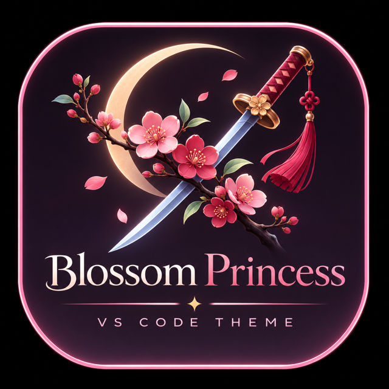
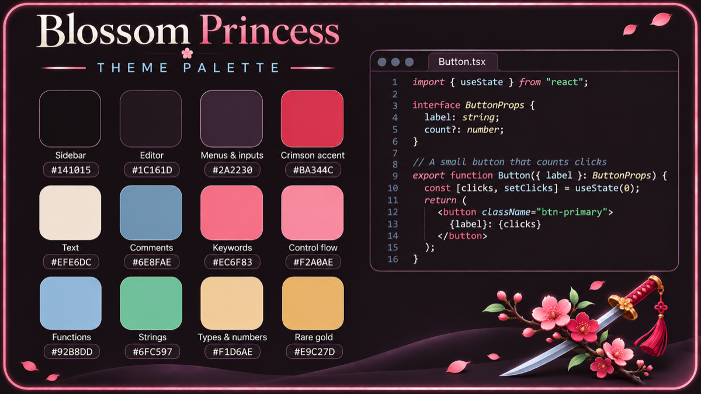

<p align="center">
  
</p>

# Blossom Princess

A dark VS Code theme with plum night, crimson silk, jade and parchment light.

## Palette



<!-- palette:start -->
| Role | Color |
| --- | --- |
| Sidebar and panels | `#141015` |
| Editor background | `#1c161d` |
| Menus, inputs and widgets | `#2a2230` |
| Selection | `#4e2a3c` |
| Buttons and badges | `#8e3045` |
| Text | `#efe6dc` |
| Comments | `#6e8fae` |
| Keywords, operators, tags | `#ec6f83` |
| Control flow (import, return, if), active icon | `#f2a0ae` |
| Functions, keys, attributes | `#92b8dd` |
| Strings | `#6fc597` |
| Types, numbers, cursor | `#f1d6ae` |
| Rare accent (this, regex, enum members) | `#e9c27d` |
<!-- palette:end -->

## Install

Search for **Blossom Princess** in the Extensions view, or run:

```
code --install-extension thaisemanuele.blossom-princess
```
